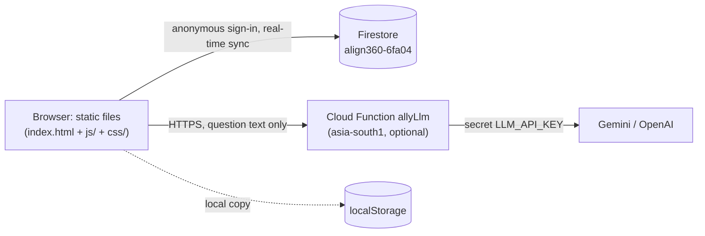

# Align360

**Team performance, quality and operations console for a support / contact-centre floor.**
One web app for daily performance data, shifts and breaks, leave, quality audits, knowledge checks, a knowledge base, escalation queue and an in-app assistant — with role-based views for Admin, WFM, Team Leaders, Trainers, SMEs, Quality, Clients and Agents.

| | |
|---|---|
| **Version** | v40 in this folder (`?v=40`); the live site currently runs v26 |
| **Stack** | HTML · vanilla JavaScript · CSS · Firebase (Firestore, Anonymous Auth, Cloud Functions) — no build step |
| **Firebase project** | `align360-6fa04` |
| **Status** | In active development; used by a live operations team |
| **Project history & decisions** | [`CLAUDE.md`](CLAUDE.md) |
| **License** | Not specified — all rights reserved by the owner until a license is added |

> **Documentation policy:** this is the **only** README. Add or update sections here; never create `README-*.md` files.
> The change history lives in `CLAUDE.md`.

## Table of contents
1. [Overview](#1-overview)
2. [Features](#2-features)
3. [Roles and access](#3-roles-and-access)
4. [Architecture](#4-architecture)
5. [Getting started](#5-getting-started)
6. [Configuration](#6-configuration)
7. [Project structure](#7-project-structure)
8. [Data model](#8-data-model)
9. [Security](#9-security)
10. [Testing](#10-testing)
11. [Troubleshooting](#11-troubleshooting)
12. [Roadmap and known limitations](#12-roadmap-and-known-limitations)
13. [Contributing and release process](#13-contributing-and-release-process)
14. [Appendix — detailed feature guides](#appendix--detailed-feature-guides)
15. [Appendix — Firestore rules](#appendix--firestore-rules)

---

## 1. Overview

**Problem.** Floor operations were run from spreadsheets (a "Team Performance Tracker" Google Sheet, an Excel "AHC Calibration Form" for quality audits, Word SOPs, copy-pasted ServiceNow notes). Data lived in individual files, access was uncontrolled, and nothing was linked: an audit, a knowledge test and a daily KPI row were three different files.

**Solution.** Align360 keeps everything in one shared, real-time app. A PKT score flows into the agent's Daily Data and the Dashboard; an audit appears on the agent's own page; a Word SOP becomes searchable Knowledge Base articles; a supervisor call is queued and assigned round-robin.

**Who it is for.** Operations teams of roughly tens to a few hundred agents: agents, team leaders, SMEs, trainers, quality analysts, workforce management (WFM), managers/admins and an external client view.

**Design principles**
- Static files, no build step, no framework — easy to host and to hand over.
- Role-based views: every person sees only what their role needs.
- Rule-based helpers over opaque AI: the KB importer and Ally run in the browser; the only AI call rewords an unclear question and never sees app data.
- No new database collection unless unavoidable (rules are edited by hand in Firebase Console).

## 2. Features

| Area | What it does |
|---|---|
| **Dashboard** | Team KPIs against targets and thresholds (AHT, Call Quality %, PKT Score %, Total Calls, **Present %**), attention list, week/month views, agent report cards, Excel export. Separate Client dashboard (high-level) and Quality dashboard (audit analytics). |
| **Daily Data** | Per-agent daily attendance and KPI entry; CSV/XLSX import; KPI cells unlock only for Present / Half day. Numbers show as whole numbers (699.449 → 699, 699.5 → 700; display only). A "Working on" bar above the table always shows the date (and agent, while editing) you are on, even when scrolling a long month. |
| **Daily Summary** | LOB-wise operations numbers for TL and above; configurable parameters and LOBs. |
| **Break Schedule** | Per-agent break timings with browser break reminders (sound, flashing tab title). |
| **Shift seasons** | US daylight-saving changes: on a set date every shift and break moves ±1 hour (Settings → Shift seasons). Applied once by the first Admin/WFM who opens the app on/after the date (or after confirming, when "auto" is off); everyone gets a pop-up from 7 days before; Revert available. Later years are scheduled automatically from the US rule. |
| **Team Roster** | Agents, TL, LOB (plus cross-trained LOBs), shift, joining/inactive dates, notes; Excel/CSV import with a column-mapping review step (map TL/LOB, shift/break/lunch times incl. ranges and one combined "Break" column, header row found automatically, default TL, preview; re-importing a file with times updates existing agents' times only); team scoping. |
| **Leave Tracker** | Leave derived from Daily Data attendance; configurable leave types. |
| **Month History** | Archived monthly rows and agent history; Process Updates (rich-text announcements with read tracking and pinning). |
| **LEO** | Supervisor-call escalation queue: create/escalate, round-robin to a supervisor rotation list, status/action workflow, SME role works assigned calls, monthly report. |
| **Quality Audit** | Replaces the Excel calibration workbook: 19-parameter rubric, Yes/No/N/A tagging, error categories, zero-tolerance rule, scoring, mandatory-reason corrections, 75-column Excel export, **backdated audit upload**. |
| **PKT** | Weekly knowledge test: Kahoot-style creator, timed attempt by agents, live results, score written to Daily Data (one score per agent per week), **backdated results upload**. |
| **Knowledge Base** | Articles with Quick answers, topics, search words, feedback votes; **import from a Word SOP**; full SOP documents with contents, find, zoom; ranked search with logging of searches that found nothing. |
| **Documentation templates** | Fill-in-the-blank ServiceNow note templates with optional clauses, suggested dispositions and an IPA/vendor directory (copy/paste into ServiceNow; no API integration). |
| **Ally** | In-app chat assistant (every page, all roles) answering only from the signed-in person's own permitted data; follow-ups, typo tolerance; optional AI rewording via Cloud Function. |
| **Audit Log** | Append-only record of key actions (Admin only). |
| **Settings** | Users and roles, data access, attendance types, KPI targets, leave types, LOBs, reasons/supervisors for LEO, backups, Production ↔ Sandbox environments. |
| **Placeholders** | EWS and Employee Engagement Zone tabs exist as "Work in progress". |

Detailed guides for the larger features are in the [Appendix](#appendix--detailed-feature-guides).

## 3. Roles and access

Page access is decided in `computeVisibleTabs()` (`js/app.js`) and the `canView…()` helpers in `js/auth.js`. Ally and every export reuse these gates.

| Role | Pages and scope |
|---|---|
| **Admin / Manager** | All pages. Audit Log is Admin-only; LEO settings (reasons, supervisors) Admin-only. |
| **WFM (plain)** | Operational pages; no Quality Audit, PKT, LEO, KB, Documentation or Process Update. |
| **Team Leader** | Own team (or all teams with "Full data access"); LEO management; audits and PKT results for the team. |
| **Trainer** | Read access to Dashboard, Roster, Breaks, Leave; Process Update, LEO, Quality Audit, PKT, KB, Documentation. |
| **SME** | Team-scoped operational pages; LEO shows only sup calls assigned to them; restricted Settings (own login only). |
| **Quality** | Audit dashboard, Quality Audit (own audits), PKT, KB, Documentation; restricted Settings. |
| **Client** | Read-only: Dashboard, Process Update, LEO, Daily Summary, Documentation. |
| **Agent** | Own data only: Dashboard, Process Update, LEO, Quality Audit (about them), PKT, KB, Breaks, Documentation. |

## 4. Architecture



- **Client-only logic:** rendering, role gates, scoring, imports/exports, Ally and the KB importer all run in the browser.
- **State:** one global `state` object (`js/state.js`) persisted to Firestore (many documents per collection, writes chunked at 400) and mirrored to `localStorage` so the app still works offline/degraded.
- **Environments:** Production and Sandbox (`js/env.js`) use prefixed collections; Admin can copy sandbox sections to production.
- **Script order matters:** `index.html` loads each file in dependency order; there is no module bundler.
- **Third-party libraries (CDN, pinned):** SheetJS xlsx 0.18.5, ExcelJS 4.4.0, Chart.js 3.9.1, Firebase compat SDK 12.16.0. Bundled: mammoth.js (BSD-2-Clause) in `js/vendor/`.

## 5. Getting started

### Prerequisites
- A modern browser; Node.js 22 only if you deploy the Cloud Function or run tests.
- A Firebase project with **Firestore** and **Anonymous Authentication** enabled. The Cloud Function additionally needs the **Blaze** plan.
- Firebase CLI: `npm i -g firebase-tools`.

### Run locally
```
cd <project folder>
npx serve .          # or: python3 -m http.server 8080
```
Open the printed address. Without a reachable Firestore the app runs from the browser's local copy.

### Connect your own Firebase project
1. Put your web config in `firebaseConfig` (`js/firebase.js`) and the project id in `.firebaserc`.
2. In Firebase Console enable Firestore and Anonymous sign-in.
3. Publish `firestore.rules` (see [Firestore rules](#appendix--firestore-rules) and [Security](#9-security)).

### Deploy the web app
The live app is hosted on **GitHub Pages**: https://align360-ahc.github.io/1/ (Firestore and the Cloud Function stay on Firebase; `firebase.json` configures functions only).
1. Upload **only the app files** to the Pages repository: `index.html`, `css/`, `js/`. Do **not** upload `README.md`, `CLAUDE.md`, `tests/`, `functions/` or `.env` — Pages serves everything in the repo publicly.
2. Bump `?v=NN` on all asset tags in `index.html` before uploading so browsers fetch the new files.
3. Wait for the Pages build to finish, then hard-refresh and check the page title and version.
4. Any other static host (Firebase Hosting, Netlify, nginx) also works.

### Deploy the AI helper (optional)
```
firebase functions:secrets:set LLM_API_KEY
cd functions && npm install && cd ..
firebase deploy --only functions
```
Confirm the printed URL matches `ENDPOINT` in `js/ally-llm.js`. To switch the AI off set `ENDPOINT = ""`. Full steps: [guide B](#b-ally-ai-helper-gemini--openai--setup).

## 6. Configuration

| Setting | Where | Notes |
|---|---|---|
| Firebase web config | `js/firebase.js` | Public by design; protect data with Firestore rules. |
| `LLM_API_KEY` | Firebase secret | Never put it in `index.html`, `js/` or `functions/.env`. |
| `LLM_PROVIDER`, `LLM_MODEL` | `functions/.env` | `gemini` (default) or `openai`; default model `gemini-2.5-flash`. |
| `ENDPOINT` | `js/ally-llm.js` | Cloud Function URL; empty string disables AI. |
| KPI targets, leave types, attendance types, LOBs, LEO reasons/supervisors, dispositions, IPA directory | Settings / Documentation (Admin) | Stored in Firestore settings. |
| Search synonyms | `KB_SYNONYMS` in `js/kb.js` | One-word synonyms only. |
| Present % definition | `isWorkingAttendance()` in `js/daily.js` | Present ÷ (Present + Half day + Leave). |

## 7. Project structure

```
index.html              app shell, script order, cache-bust version
css/                    app.css · components.css · responsive.css · ally.css
js/
  env.js state.js auth.js firebase.js utils.js app.js        core: environments, state, login/roles, Firestore sync, helpers, router
  dashboard.js clientdashboard.js qualitydashboard.js reports.js      dashboards and charts
  daily.js dailysummary.js import-export.js roster.js breaks.js leave.js history.js     operations pages
  shiftseason.js                                              US daylight-saving shift changes (dated schedule, pop-ups, Settings section)
  leo.js leoreport.js                                         supervisor-call queue
  qualityaudit.js qa-backdated.js                             audits (+ past-audit upload)
  pkt.js pkt-editor.js pkt-play.js pkt-backdated.js           knowledge tests
  kb.js kb-docs.js kb-editor.js kb-ai.js kb-import.js         knowledge base
  documentation.js docgen.js                                  note templates
  audit.js settings.js ews.js engagementzone.js               audit log, settings, placeholders
  ally-scope.js ally-lang.js ally-nlu.js ally-engine.js ally-llm.js ally-ui.js     Ally assistant
  vendor/mammoth.browser.min.js                               Word reader (BSD-2-Clause)
functions/              Cloud Function allyLlm (Node 22)
tests/                  Node + jsdom checks (Ally)
firestore.rules.*-snippet.txt    rules blocks to paste in Firebase Console
firestore.rules         interim Firestore rules (see Security)
README.md               the only README          CLAUDE.md   project memory and changelog
```

## 8. Data model

| Collection | Contents |
|---|---|
| `trackerSettings` | Settings, users and role config |
| `trackerRoster` | Agents |
| `trackerDaily` | Daily attendance and KPI rows |
| `trackerDailySummary` | LOB daily summary numbers |
| `trackerHistory` | Archived month data (Month History) |
| `trackerQualityAudits` | One document per audit (including backdated) |
| `trackerPkt`, `trackerPktAttempts` | Tests and attempts (`pktId__empId`) |
| `trackerKb`, `trackerKbFeedback` | Articles, full documents (`kind:"document"`/`"docpart"`), votes and no-result searches |
| `trackerAuditLog` | Append-only action log |
| `trackerMisc` | Single documents: `leoCalls`, `processUpdates`, `shiftSwaps`, `documentationTemplates`, `ipaDirectory` |

Sandbox uses the same collection names with an environment prefix (`js/env.js`).

## 9. Security

**What exists:** salted SHA-256 password hashing, per-role UI gating, an append-only audit-log rule, Ally scoping that is tested for leaks, AI key held as a Firebase secret, per-visitor rate limit and instance cap on the Cloud Function.

**Known limitations (important):**
1. The production Firestore rules allow **any signed-in user to read and write every document**, and the app signs every visitor in anonymously. On a public site that means anyone can read, change or delete all data. (Reviewed 2026-11-02.)
2. Login is verified **in the browser**; credential hashes are part of the data every visitor downloads.
3. Role limits are enforced in the UI only. The rules snippets in the repo (audit log append-only, KB, PKT, sandbox) were not part of the production rules reviewed.

Decided fix: real per-user logins (Firebase Authentication) with strict per-role Firestore rules — staged plan in `CLAUDE.md` §6.

Until that is done, treat the app as **not safe for sensitive data**. Do not store government IDs, health data or other sensitive personal data in it. Report security concerns to the project owner privately, not in public issues.

## 10. Testing

Tests cover Ally (permissions, leak checks, AI helper with a mocked function). jsdom is not listed in a `package.json`; install it (`npm i jsdom`) and set `NODE_PATH`. Always set `SRC` to the project folder.
```
SRC=<project folder> node tests/run.js    # 27 questions × 9 roles — expect "LEAKS: 0"
SRC=<project folder> node tests/adv.js    # data-extraction attempts — expect "BAD: 0"
SRC=<project folder> node tests/llm.js    # AI helper, mocked — expect "8 passed, 0 failed"
SRC=<project folder> node tests/conv.js <role> '["question 1","question 2"]'    # transcript
```
Baseline for v27: all pass. There are no automated tests for the other pages.

## 11. Troubleshooting

| Symptom | Likely cause / fix |
|---|---|
| Old behaviour after an update | Browser cached files — bump `?v=NN` in `index.html`, hard refresh. |
| "Saved locally in this browser" never changes to synced | Firestore unreachable, anonymous sign-in disabled, or rules reject writes. |
| Big upload does not sync | Firestore batches are limited to 500 writes; the app commits in chunks of 400 — check rules and network. |
| Ally AI never helps with unclear questions | Function not deployed, `ENDPOINT` mismatch, or paused for 5 minutes after 3 failures. |
| KB import shows nothing | File must be `.docx` (or `.txt`/`.md`); headings must use Word Heading styles. |
| Templates have no dispositions / IPAs | Admin must fill both lists first (Documentation → Manage dispositions & IPA directory). |
| Tests fail to start | jsdom missing or `SRC` not set. |

## 12. Roadmap and known limitations

- **Security hardening (highest priority, decided):** real per-user logins (Firebase Authentication), complete Firestore rules and server-side role enforcement. Staged plan in `CLAUDE.md` §6.
- EWS and Employee Engagement Zone are placeholders.
- **Client = totals only (decided):** the Client dashboard already shows no per-agent tables; Ally and the underlying data access still need to be restricted. Fix Month History scope for TLs without Full data access (reported, to be re-verified).
- No ServiceNow API integration (copy/paste by design); richer template logic (if/else) not supported.
- Automated tests for non-Ally pages; make `tests/` self-contained (package.json, default `SRC`).
- KB documents are not included in the local copy or Settings backup (re-import the `.docx`).
- Add a license, screenshots and a hosting configuration when the project is shared outside the team.

## 13. Contributing and release process

1. Describe the change and check it against the role matrix (who may see/do it).
2. Reuse existing gates and helpers; avoid new collections (if unavoidable, add a rules snippet).
3. Run the tests; bump `?v=NN` in `index.html`.
4. Update **this README** (the relevant section) and add a dated entry to the changelog in **`CLAUDE.md`**.
5. Ship the whole project as one zip named `align360-<short-description>-vNN.zip`.

Conventions: vanilla JS, no framework or bundler; one file per page under `js/`; comments explain *why* (rules and decisions), not *what*.

---

## Appendix — detailed feature guides

### A. Ally — in-app assistant (bottom-right chat bubble)

**What it is:** a chat bubble on every page, for every logged-in role. It answers questions from Align360's own data only.
No internet, no AI service, no API key — it is a rule-based engine running in the browser (same approach as the KB importer).
Nothing is sent anywhere, and the chat is kept in memory only (wiped on logout / when another person signs in).

#### The data rule
Ally can never know more than the person's own pages show them. `js/ally-scope.js` is the ONLY file that reads app data;
it is built on the app's existing gates (`computeVisibleTabs`, `scopedRoster`, `scopedLeoCalls`, `qaVisibleAudits`, `kbVisible`, …),
so it follows role changes automatically.

| Login | Ally can answer about |
|---|---|
| Agent | own KPIs, attendance/leave, shift & breaks, swaps, audits, PKT, sup calls; KB / templates / updates for their LOB. No other person, no team figures, no rankings. |
| SME / TL | their team (TL with Full data access: all teams). SME sees only sup calls assigned to them (as in LEO). |
| Trainer | all teams: KPIs, roster, shifts, leave, audits, PKT, LEO, KB, docs, updates |
| Client | Dashboard-level numbers, Daily Summary, LEO, updates, docs (no roster/shifts/audits/PKT/KB) |
| Quality | audits they submitted, PKT results, KB, docs, updates (no KPIs/roster) |
| WFM / Manager / Admin | everything their pages show (plain WFM: no audits/PKT/LEO/KB/docs/updates, as in the app); Audit Log: Admin only |

Never exposed to anyone: passwords/hashes/security answers/user list, PKT questions & answer keys, roster notes, silent QA corrections.
Asking about a colleague gets the same refusal whether or not that person exists (no roster probing). Typing "I am the admin" changes nothing.

#### Files
`js/ally-scope.js` (permissions) · `js/ally-nlu.js` (understanding the question) · `js/ally-engine.js` (answers) · `js/ally-ui.js` + `css/ally.css` (widget)
Edits to existing files: `index.html` (css + 4 scripts), `js/app.js` (one line in `__renderInner` that calls `AllyUI.onRender()`).
No new Firestore collections or rules.

#### Tests
`tests/` (Node + jsdom): `node run.js` runs 27 questions as each of 9 roles and checks for leaked secrets; `node adv.js` tries to extract
other people's data as Agent / TL / SME / Quality. Run with `SRC=<project folder>`.

#### Things I found in the existing app (not changed, worth a look)
1. **Everything is loaded into every browser** (all agents' daily data, audits, etc.); role limits are enforced in the UI only. Ally respects the limits,
   but anyone with DevTools can already read more. Real enforcement needs Firestore rules / a backend.
2. **Month History for TL**: `history.js` filters rows for Agent and SME but not for a TL without Full data access, so such a TL sees every team's archived rows. Ally applies the stricter team scope.
3. **Client** (decided: totals only): the Client Dashboard shows no per-agent tables, but Ally currently answers per-agent questions for Client (`rawPeople` / `reachOf` in `js/ally-scope.js`). To be changed in security migration Step 4 (see `CLAUDE.md` §6).

#### v17 — conversation, spelling and voice

- **Follow-ups.** Ally remembers the previous question: "who is on leave today" → "check for August" → "and tomorrow" keeps the topic and the "who" shape; "aht of Rahul" → "and cq" → "his leave" keeps the person; "last month" re-runs the last answer for that month. Ally also asks short yes/no questions ("Want me to check the whole month?") — "yes" runs it — and "the first one" picks from a list of matching people.
- **Spelling and chat shorthand.** `js/ally-lang.js` fixes typos (agust, lave, attendence, septembr, tomorow), shorthand (wat, tdy, u, pls, pndng) and number words ("top five"). Corrections are shown ("I read “agust” as “august”") so a wrong guess is visible. Words are only ever corrected towards things the signed-in login may see (an Agent's typo is never "fixed" into a colleague's name).
- **Own voice.** Answers are written as sentences with insight: gap to target, trend vs previous month, which metric needs attention, and honest empty states ("attendance for tomorrow isn't filled in yet" instead of "nobody is on leave").
- **Small talk / meta.** Greetings, "how are you", "who are you", "that's wrong" (Ally says what it understood and asks you to rephrase), and off-topic requests (politely declined: Align360 data only).
- **Permissions unchanged.** Every follow-up goes through the same `AllyScope` gate. An Agent's "who is on leave" followed by "check August" stays refused; "his aht" / "and Rahul" is refused uniformly.
- Tests: `node tests/run.js`, `node tests/adv.js` (leak checks), `node tests/conv.js <role> '["q1","q2"]'` (conversation transcript). Set `SRC` to the app folder.

#### Cross-trained agents (multiple LOBs)
An agent has one primary LOB (`lob`) plus optional cross-trained LOBs (`extraLobs`). Ally's person data carries both (`lob`, `lobs`), so "who is on Eligibility" includes cross-trained agents, an agent's profile lists all their LOBs, and an agent only ever gets Knowledge Base / template / update / PKT content for the LOBs they are trained on (those checks reuse the app's own visibility functions).

#### AI helper (optional)
Unclear questions can be reworded by Gemini/OpenAI through a Cloud Function — see [guide B](#b-ally-ai-helper-gemini--openai--setup). Data scoping is unchanged.

### B. Ally AI helper (Gemini / OpenAI) — setup

**What it does.** When Ally's rules can't understand a question, an AI model rewords it into a question Ally understands
(e.g. "how many ppl didn't turn up yesterday" -> "who is on leave yesterday"). Ally then answers from the user's own scoped data,
exactly as before. The model never sees Align360 data and never writes the answer.

**What leaves the browser:** only the typed question (and the previous question, for follow-ups). No role, no names from the app, no figures.

#### Where the key lives
Only as the Firebase secret `LLM_API_KEY`. It is NOT in index.html or any file in js/ (anything there is readable by every user).

#### One-time deploy (needs Node 22 and the Firebase Blaze plan — Cloud Functions that call outside APIs require it)
```
npm i -g firebase-tools
firebase login
cd <this folder>
firebase functions:secrets:set LLM_API_KEY      # paste the key when asked
cd functions && npm install && cd ..
firebase deploy --only functions
```
Then check the URL printed for `allyLlm`. It should be `https://asia-south1-align360-6fa04.cloudfunctions.net/allyLlm`;
if it differs, update `ENDPOINT` in `js/ally-llm.js`.

#### Options (functions/index.js params)
- Provider: `LLM_PROVIDER=gemini` (default) or `openai`. Model: `LLM_MODEL` (default `gemini-2.5-flash`; use e.g. `gpt-4o-mini` for OpenAI).
  Set them in `functions/.env` (e.g. `LLM_MODEL=gemini-2.5-flash`) before deploying. If a model name is retired, change it there.
- Switch the AI off: set `ENDPOINT = ""` in `js/ally-llm.js`.

#### Safety notes
- Firebase sign-in here is anonymous (roles are checked in the app), so the function can't tell roles apart. It holds no data, owns the prompt,
  limits each visitor to 12 requests/minute and at most 5 instances run at once. Set a monthly budget cap in Google AI Studio / OpenAI too.
- A tricked model can only produce a question, and that question still goes through `AllyScope` — an Agent can't widen their own access (tested in `tests/llm.js`).
- If the call fails or the function isn't deployed, Ally silently behaves as before (it pauses AI calls for 5 minutes after 3 failures).
- Tests: `SRC=<folder> node tests/llm.js` (mocked function), plus the existing `run.js` / `adv.js`.

### C. Knowledge Base — import from a Word document

**Where:** Knowledge Base tab → **📄 Import from document** (Trainer, TL, SME, Quality, Admin).

1. Pick who the SOP is for (a LOB or General) and upload the SOP (.docx; .txt / .md also work).
2. The app finds the topics, writes a ⚡ Quick answer for each, converts steps / tables / notes / warnings /
   screenshots, and suggests search words.
3. Review screen: tick / untick articles, fix title, topic, LOB, quick answer or details, then
   **Save as drafts** (recommended) or **Publish**.

How topics are decided: each Word Heading becomes an article; the heading above it becomes the topic (category).
Revision history / approvals / "Purpose" / "Scope" style sections come up unticked.
Re-uploading a revised SOP updates the same articles (matched by file name + title). Articles edited by hand since
the last import default to Skip so nobody's edits are overwritten.

**No AI service is called.** The engine (`js/kb-ai.js`) is rule-based and runs in the browser; the document never leaves
the browser. Word files are read with mammoth.js (`js/vendor/`, BSD-2-Clause), loaded only when the screen is opened.
To plug in a hosted language model later, replace `kbAi.fromHtml` / `kbAi.fromText` — the review screen and the output
shape are unchanged (the model call must go through a server-side function; never put an API key in this app).

No new Firestore collections or rules. Imported articles carry an extra `source:{file,section,importedAt,hash}` field.
Also changed: numbered lists in articles now keep their numbering when resumed after a note (`<ol start>`).

Files: `js/kb-ai.js` (engine), `js/kb-import.js` (screens), `js/vendor/mammoth.browser.min.js`, small edits in
`js/kb.js`, `css/components.css`, `index.html`.

### D. Knowledge Base — full documents and sharper search (v19)

#### 1. Agents can open the complete Word file
**Import from document** now has a ticked box **"Also keep the complete document"**. On the review screen a blue card shows
what will be stored (sections / images / size), lets you rename it and choose who can open it, and it is saved/published together
with the articles (or on its own — untick all articles and keep only the document).

Agents see it on the Knowledge Base home page under **📄 Full documents (SOPs)** and inside search results
("📄 Found in the full documents"). The reader has a contents list that follows your scroll, 🔎 Find (highlights every match,
Enter / Shift+Enter to move), screenshots with click-to-zoom, and copy-on-click for phone numbers/codes.
Imported articles get **"Open this part of the full document →"**, which jumps to the matching heading.

* Everything is kept in order — including Revision history / Purpose / Scope that are skipped as *articles*.
* Re-importing a revised file with the **same file name replaces** the document (same link). Manage articles → **Full documents** table:
  View / Publish / Unpublish / Delete.
* Storage: same Firestore collection as the articles (`trackerKb`, rows with `kind:"document"` / `kind:"docpart"`) —
  **no new collection and no rules change**. Big documents are split into ≤ ~700 KB parts; picture budget 4.5 MB per document
  (extra pictures are dropped with a warning on the review screen). Documents are left out of the localStorage copy and the
  Settings backup (they live in the cloud; re-import the .docx if you ever need to rebuild).
* Not stored: the original `.docx` binary. Agents see a faithful web rendering (headings, lists, tables, images, bold/italic, links);
  Word-only features (text boxes, tracked changes, fancy layout) are not reproduced.

#### 2. What changed in search / reading
* Whole-word / word-start matching. Before, "ad" matched every word containing "ad"; now it doesn't, and "print" still finds "printer".
* Light stemming (resets / resetting → reset), filler words ignored ("how do I…"), short synonym list (`KB_SYNONYMS` in `js/kb.js` —
  edit it to your own jargon; one-word synonyms only, use each article's **Search words** for phrases like "sign in").
* Ranking: title > search words > section headings > quick answer > category > body; exact-phrase bonus; helpful 👍/👎 votes nudge order.
* Results show **which section** answered the question and open the article scrolled to it with the words highlighted.
* Typo tolerance only kicks in for a word that matches nothing.
* Articles: "On this page" contents chips (3+ headings), 🔎 Find, "You may also need" related articles.
* **Searches that find nothing are now logged** (once per person per question per day; staff searches excluded) and appear in
  Feedback → "🔍 Searched — no result" with a count. **＋ Write article** pre-fills the title and search words, and publishing it
  resolves the line for everyone who searched it. This is how the KB gets complete from real doubts instead of guesses.

Files: `js/kb-docs.js` (new), `js/kb.js` (search + reader), `js/kb-import.js`, `js/kb-ai.js` (`full` output + section anchors),
`js/kb-editor.js` (documents table, no-result searches), `js/firebase.js` + `js/state.js` (document rows), `css/components.css`, `index.html`.

### E. Present %, backdated Quality Audits, backdated PKT results (v25)

No new Firestore collections and no rule changes: backdated audits live in `trackerQualityAudits`,
backdated PKTs in `trackerPkt` / `trackerPktAttempts` (rules already cover them).

#### 1. Dashboard — Present %
Present % = Present days ÷ working days. Working days = Present + Half day + Leave (days the agent was
expected to work and has an attendance mark). WeekOff, Client holiday and unmarked days are left out.
Shown as a new KPI card ("Present %", with "x of y working days"), as Present / Present % columns in the
Attention / Week / Month tables, on the agent Report Card, in the Excel export (Weekly + Monthly sheets) and in
Month History archives. Change the definition in `isWorkingAttendance()` in js/daily.js.

#### 2. Quality Audit → "📤 Upload past audits" (Admin / Manager / Quality)
File layout = the same 75 columns as "Download Excel" on Audits (the old workbook's DUMP tab), so the old DUMP
rows can be pasted straight in and an exported file can be edited and re-uploaded. "Download template" gives
the headers, a "How to fill" sheet and a roster-names sheet.
- Same validation as a live audit (agent on roster, all 19 tagged, N/A only where allowed, "No" needs an error
  category, ZTP Not Met needs a policy). Score is always recalculated from the tags.
- Preview before saving; problem rows are skipped and can be downloaded as an issues file.
- Duplicate Call IDs: skip (default) or import anyway.
- Stored with `backdated:true`, original audit date, uploader, batch id. Shows a "Backdated" badge in the list and
  a banner on the detail page; list can be filtered "Backdated only". Sorted by audit date, not upload time.
- Agents are NOT notified (no sidebar badge / "New" tag) unless "Notify agents" is ticked.
- "Undo upload" removes a whole batch (Admin, or the person who uploaded it).
- Excel download gained 3 columns at the end: Backdated, Uploaded By, Uploaded On.

#### 3. PKT → "📤 Upload past results" (Quality / Admin / Manager)
Upload the RESULTS of PKTs held earlier. One file may contain several PKTs.
Columns: PKT Title, Test Date, Emp ID and/or Agent Name, Score (%) or Correct + Total Questions,
Pass Mark (%), Time Taken (min), LOB. Title / date / LOB / pass mark can also be set once in the boxes on screen.
- Rows with the same Title + Test Date = one PKT, saved as a closed "Backdated" PKT (no questions; agents can't take it).
- Score from Correct/Total when both given; else Score (%). 0–100. Pass/Below vs pass mark.
- Score is written to Daily Data → PKT Score (%) on the test date. Existing rule kept: ONE PKT score per agent per
  week. If the week already has one, the result is kept on the PKT, flagged "Week already scored", and Daily Data is
  left alone — unless "Replace the week's score in Daily Data" is ticked. The preview shows who is affected.
- Agent already has a result for that PKT: skip (default) or replace.
- Results page, agent's "My PKT results", Excel export (single sheet) and the Dashboard all handle backdated PKTs.
  The live PKT dashboard card and default Results selection ignore backdated PKTs.
- "Undo upload" removes the PKTs/results and takes the scores it wrote back out of Daily Data
  (a score it replaced is put back).

#### 4. Fix included — Firestore 500-write limit
`pushToFirestore()` used a single batch; Firestore rejects batches over 500 writes, so a big upload would have
failed to sync. Writes are now committed in chunks of 400 (`chunkedBatch()` in js/firebase.js).

#### New / changed files
New: js/qa-backdated.js, js/pkt-backdated.js
Changed: js/daily.js, js/dashboard.js, js/history.js, js/import-export.js, js/qualityaudit.js, js/pkt.js,
js/firebase.js, index.html (new script tags, cache-bust ?v=24)

### F. Documentation templates — fill and generate

This update turns the Documentation Template section from a copy-paste library into a
fill-in-the-blanks system: agents fill a short form, get a ready-to-paste note, and copy
it into ServiceNow's Final Notes field — instead of hand-editing a pasted block on every
call.

Nothing about how the note gets into ServiceNow changed (still copy/paste, see
**Integration status** below). What changed is how fast and consistent it is to produce
that note in the first place.

---

#### What's new, at a glance

| Piece | What it does |
|---|---|
| **Call details panel** | Fill 12 common fields (Member ID, Claim Number, DOB, etc.) once per call. Every template pulls from it automatically. |
| **Token syntax in templates** | Trainer/TL/Admin write templates with `{{placeholders}}` instead of hardcoded example text. |
| **Fill & generate modal** | Agent clicks "Use template," fills only what's specific to that template, sees the finished note update live. |
| **Optional clauses** | `[[ ]]` and `{{list:...}}` make a sentence disappear cleanly when its info wasn't shared on the call — no dangling blanks or stray punctuation. |
| **Suggested disposition** | Each template can carry one or more suggested ServiceNow dispositions, with a plain-language rule for when to pick which. |
| **IPA / Vendor directory** | Look up an IPA by name once — phone and address auto-fill, still editable per call. |
| **Native spellcheck** | The fill form and generated note both have browser spellcheck enabled. |

---

#### For agents: how to use it

1. Open **Documentation Template**.
2. Expand **📞 Call details** at the top and fill in what you have (Member ID, Claim
   Number, DOB, etc.). This is once per call — leave it filled while you use multiple
   templates during the same call.
3. Find your template, click **📝 Use template**.
4. If the template has a suggested disposition, it's shown at the top with its own Copy
   button — that's a second thing you'll select in ServiceNow, separate from the note.
5. Fill in whatever's specific to this template (dates, IPA name, etc.). The **Generated
   note** box below updates as you type.
6. Use **Additional notes** for anything from the call the template doesn't cover — leave
   it blank and it won't show up in the note at all.
7. Review the generated note, fix anything by hand if needed, then **📋 Copy note** and
   paste into ServiceNow's Final Notes.
8. When the call ends (or you start a new one), click **Clear (new call)** on the Call
   details panel.

**Nothing in Call details or the fill form is saved anywhere** — it only lives on your
screen for that call and clears on logout. If you refresh the page mid-call, you'll need
to re-fill it.

---

#### For Trainers / TL / Admin: how to write a template

Templates are still posted the same way (Documentation → **+ Post template**), with one
addition: write the body using tokens for anything that changes per call.

##### Token reference

| Syntax | What it does |
|---|---|
| `{{field_name}}` | A plain fillable text field. |
| `{{field_name:date}}` | Renders as a date picker. |
| `{{field_name:select:A\|B\|C}}` | Renders as a dropdown with those options. |
| `[[ ... ]]` | Wraps an optional clause — the whole thing (words, punctuation, and all) disappears if every `{{token}}` inside it is left blank. |
| `{{list:f1=Label 1,f2=Label 2,...}}` | Joins whichever of `f1`/`f2`/... the agent filled in, with correct "and"/comma punctuation. Renders to nothing if none were filled. |
| `{{additional_notes}}` | Placed alone on its own line, ideally at the end. Optional catch-all — disappears if left blank. |

**Reserved names** — these exact field names auto-fill from the Call details panel
instead of asking the agent again on that template, so reuse them rather than inventing
new ones:

```
caller_name, callback_number, claim_type, member_id, member_name, member_dob,
company_id, state, date_of_service, bill_amount, claim_number, npi_tax_id
```

`agent_name` and `today` are also reserved and fill automatically (agent's logged-in name
and today's date) — no field is shown for either.

##### Important: wrap a `{{list:...}}` together with its sentence

On its own, `{{list:...}}` only removes the *missing values* — not the sentence around
it. If you want the whole clause to vanish when nothing was filled, wrap the connector
words and the list token together in `[[ ]]`:

```
[[Informed the provider and provided {{list:ipa_name=the IPA name,ipa_phone=phone number,ipa_address=address}}.]]
```

##### Worked example

Template as typed (Category: **Claim Denied**, Sub Category: **IPA Responsibility**):

```
Spoke with the provider regarding the claim status. Denied as IPA
responsibility.[[ Claim received date: {{claim_received_date}}.]][[ Claim
Denied in: {{claim_denied_date}}.]][[ Informed the provider that the claim
was denied due to IPA responsibility and provided {{list:ipa_name=the IPA name,ipa_phone=phone number,ipa_address=address}}.]]

{{additional_notes}}
```

If the agent only has an IPA name (no phone or address, no dates, no extra notes), the
generated note is simply:

```
Spoke with the provider regarding the claim status. Denied as IPA
responsibility. Informed the provider that the claim
was denied due to IPA responsibility and provided the IPA name Preferred Health IPA.
```

If nothing at all is filled in, it cleanly falls back to just the base sentence — no
blank fields, no dangling punctuation.

##### Suggested disposition

When posting or editing a template, check one or more dispositions from the master list
and optionally add a short rule (e.g. "if provider confirmed no refiling needed"). If you
check more than one, the rule text is what tells the agent which to pick — write it as a
plain, checkable fact from the call, not a judgment call.

---

#### Admin setup (one-time, before this is usable)

Two master lists start **empty** and must be populated by an Admin before templates can
use them:

1. **Disposition master list** — Documentation → **⚙ Manage dispositions & IPA
   directory** → add each disposition value **exactly as it appears in ServiceNow's
   dropdown**. This is the single source of truth every template's checklist pulls from.
2. **IPA / Vendor directory** — same panel → add each IPA's name, phone, and address.
   Agents search by name in the fill form; phone/address auto-fill from here.

Only Admins can add/remove entries in either list, to keep them from drifting into
inconsistent variants across different Trainers/TLs. Trainer/TL can still select from
whatever's there when authoring a template.

---

#### Data & privacy

- **Call details (Tier 1) and per-template fill values are never persisted.** They live
  only in the browser tab's memory for the duration of the call, and are cleared on
  logout or when "Clear (new call)" is clicked.
- **Template usage is audit-logged by identity only** — which template (title/subtitle/
  LOB) was used and by whom, never the actual field values (Member ID, DOB, etc.) that
  were typed in.
- The disposition master list and IPA directory **are** persisted (they're
  non-call-specific reference data, same as your LOB list or leave types).

---

#### Integration status (ServiceNow)

This release does **not** connect to ServiceNow directly — the agent still copies the
generated note and disposition and pastes them in manually. That was a deliberate choice:
it needed no new backend, no ServiceNow credentials, and no InfoSec/compliance review to
ship, while still eliminating the actual time cost (composing/editing the sentence by
hand). A real API integration remains a separate, larger initiative if it's ever wanted —
see the "How Align360 will communicate with ServiceNow" discussion for the tiers
considered and what each would require.

---

#### Files changed in this update

- `js/docgen.js` — new file. Token engine, Call details panel, admin management panel,
  and the fill/generate modal.
- `js/documentation.js` — disposition picker + token help text in "Post template";
  entry rows show suggested disposition; "Copy" replaced with "Use template".
- `js/state.js` — new `state.ipaDirectory` and `state.settings.dispositionOptions`,
  plus template entries now carry a `dispositions` array.
- `js/app.js` — `docSession` (in-memory call data) cleared on logout.
- `css/components.css`, `css/responsive.css` — styling for the new panels and modal,
  including mobile layout.
- `index.html` — registers `js/docgen.js`.

#### Known limitations / natural next steps

- Disposition and IPA lists start empty — need Admin setup before first use.
- No conditional-wording logic beyond `[[ ]]` and `{{list:...}}` (e.g. no `if/else`
  branching) — covers the scenarios discussed so far, but a more complex scenario might
  need a genuinely different template rather than one template handling everything.
- Spellcheck is native-browser only (Tier 0) — no custom claims-terminology dictionary or
  grammar checking yet; see the earlier discussion for what a Tier 1/2 upgrade would need.
- No ServiceNow API integration (see above) — still copy/paste by design, for now.

---

## Appendix — Firestore rules
`firestore.rules` is an **interim** complete rules file (collection allowlist, append-only Audit Log, `sbx_` sandbox). It does not stop anonymous visitors from reading or deleting data — see [Security](#9-security). Publish it in Firebase Console → Firestore → Rules, keep the old text to revert, then test every page and the Sandbox.

Older snippets (superseded by that file, kept for reference):
- `firestore.rules.audit-log-snippet.txt` — makes the Audit Log append-only at database level.
- `firestore.rules.kb-snippet.txt` — Knowledge Base collections.
- `firestore.rules.pkt-snippet.txt` — PKT collections.
- `firestore.rules.sandbox-snippet.txt` — Sandbox environment.
